<div align="center">

# Quadrotor NMPC with acados

**Real-time nonlinear model predictive control for a Crazyflie 2.x nano-quadrotor, simulated in PyBullet**

[](https://github.com/Anirudha-kw/acados-quadrotor-nmpc/actions/workflows/ci.yml)


[](LICENSE)

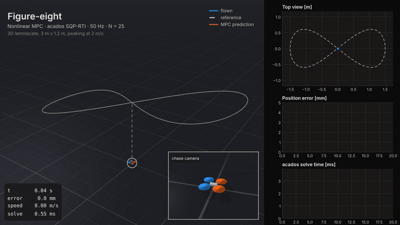

<sub>Figure-eight at up to 2 m/s: <b>0.57 mm RMSE</b>, <b>0.65 ms</b> mean solve time at 50 Hz.
Orange: the controller's 0.5 s prediction. <a href="media/figure_eight.mp4">Full-resolution video (MP4)</a></sub>

</div>

---

## Highlights

- **Full nonlinear model.** Quaternion rigid-body dynamics (13 states: position, velocity, attitude, body rates) with collective thrust and body torques as inputs. No small-angle approximations.
- **Real time with margin.** acados SQP-RTI with HPIPM: 0.6–0.8 ms mean and at most 4.2 ms per solve, against a 20 ms control period.
- **Exact actuator limits.** Each rotor's thrust is constrained to the Crazyflie's real range, `0 ≤ M⁻¹u ≤ f_max`, plus slew-rate limits on the inputs.
- **Dynamically consistent references.** Attitude, body-rate and thrust references come from differential flatness, so the attitude reference matches the tilt each path needs.
- **Offset-free under wind.** A disturbance observer feeds an external-acceleration estimate into the prediction model, which cuts RMSE by 2.9× in gusty wind.
- **Reproducible and tested.** Seeded stochastic wind, unit tests, a CI job that builds acados and flies the vehicle, and one script that regenerates every figure and video here.

## Results

All numbers come from `scripts/make_media.py` (raw values in [`media/results.json`](media/results.json)). Solve
time is the wall-clock time acados reports for one SQP-RTI iteration (`time_tot`), single-threaded on a shared
4-vCPU cloud VM.

| Scenario | What it does | RMSE | Max error | Mean / p99 / max solve |
|---|---|---:|---:|---:|
| **Figure-eight** | 3D lemniscate (3 m × 1.2 m), up to 2.0 m/s | 0.57 mm | 0.97 mm | 0.65 / 1.51 / 3.31 ms |
| **Circle** | three 1 m-radius loops at 1.6 m/s | 0.64 mm | 0.84 mm | 0.61 / 1.36 / 2.23 ms |
| **Point-to-point** | quintic take-off to (1, 1, 1) m | 0.17 mm | 0.94 mm | 0.56 / 1.38 / 2.07 ms |
| **Wind rejection** | hold position in gusty wind, observer on | 3.2 mm | 11.9 mm | 0.77 / 1.53 / 4.17 ms |
| Wind rejection, observer off | same wind realisation, for comparison | 9.2 mm | 25.3 mm | 0.80 / 1.71 / 4.16 ms |

<table>
  <tr>
    <td align="center" width="50%">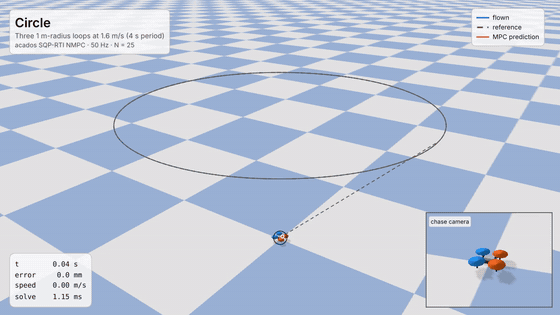<br><sub><b>Circle</b>: three 1 m loops at 1.6 m/s · <a href="media/circle.mp4">MP4</a></sub></td>
    <td align="center" width="50%">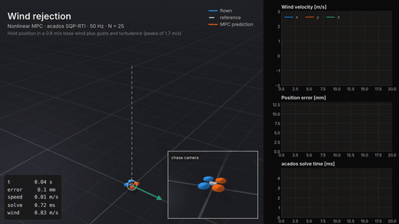<br><sub><b>Wind rejection</b>: holding position in gusts · <a href="media/wind.mp4">MP4</a></sub></td>
  </tr>
  <tr>
    <td align="center" width="50%">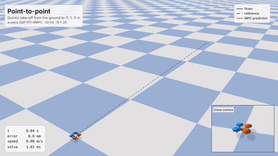<br><sub><b>Point-to-point</b>: take-off to (1, 1, 1) m · <a href="media/point_to_point.mp4">MP4</a></sub></td>
    <td align="center" width="50%">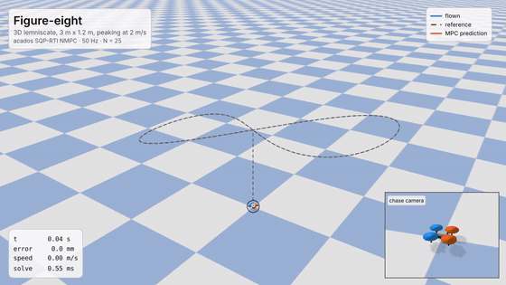<br><sub><b>Figure-eight</b>: 3D lemniscate · <a href="media/figure_eight.mp4">MP4</a></sub></td>
  </tr>
</table>

### Tracking a figure-eight

<picture>
  <source media="(prefers-color-scheme: dark)" srcset="media/figure_eight_dark.png">
  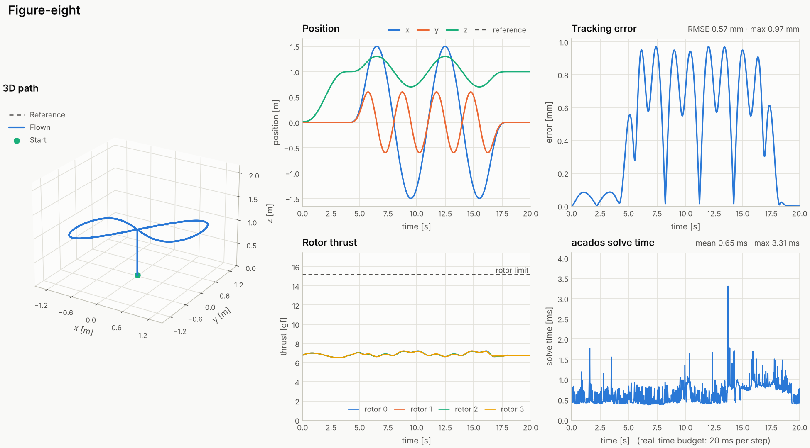
</picture>

### Wind rejection: why the disturbance observer matters

The same seeded wind is applied with and without the observer: a 0.8 m/s base wind plus sinusoidal variation,
1-cos gusts and Dryden-style turbulence, peaking at 1.7 m/s. Without the observer, drag is an unmodelled force
that pushes the vehicle downwind before the MPC can react. With it, the estimate follows the true drag closely and
the error drops from 9.2 mm to 3.2 mm RMSE (peak 25.3 mm → 11.9 mm).

<picture>
  <source media="(prefers-color-scheme: dark)" srcset="media/wind_comparison_dark.png">
  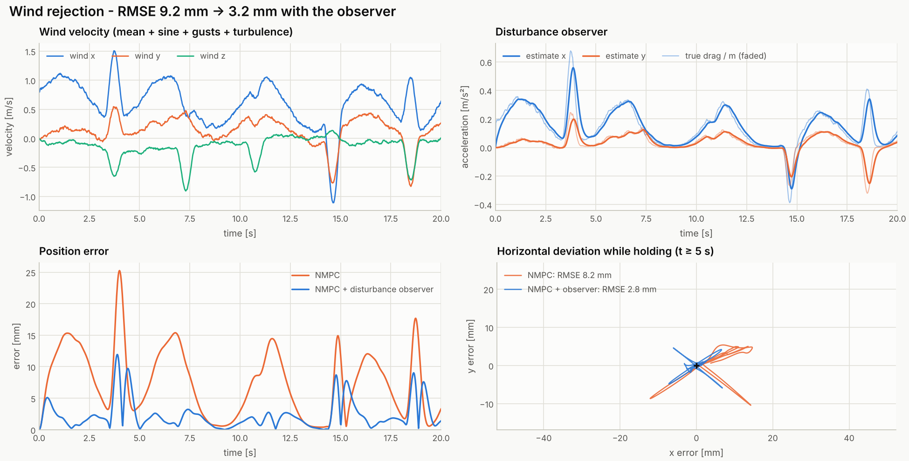
</picture>

<details>
<summary><b>More figures</b>: circle, point-to-point, wind, solver timing</summary>

<picture>
  <source media="(prefers-color-scheme: dark)" srcset="media/circle_dark.png">
  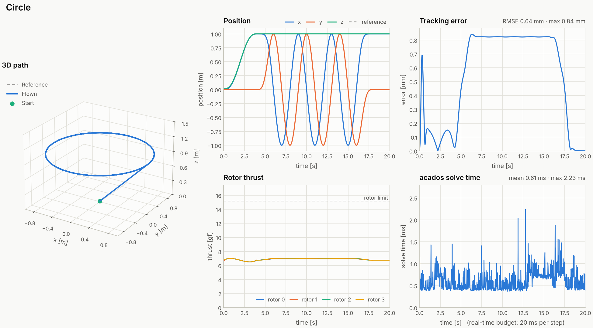
</picture>
<picture>
  <source media="(prefers-color-scheme: dark)" srcset="media/point_to_point_dark.png">
  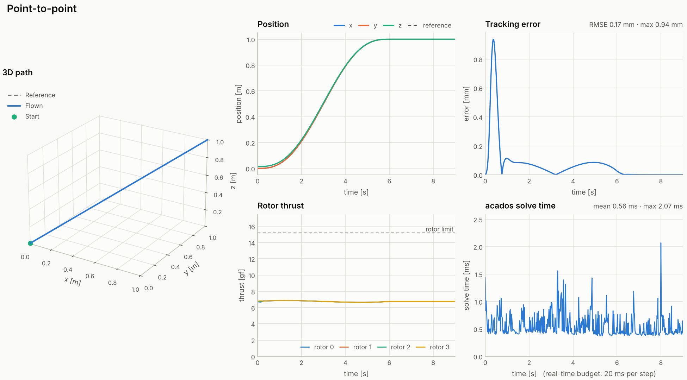
</picture>
<picture>
  <source media="(prefers-color-scheme: dark)" srcset="media/wind_dark.png">
  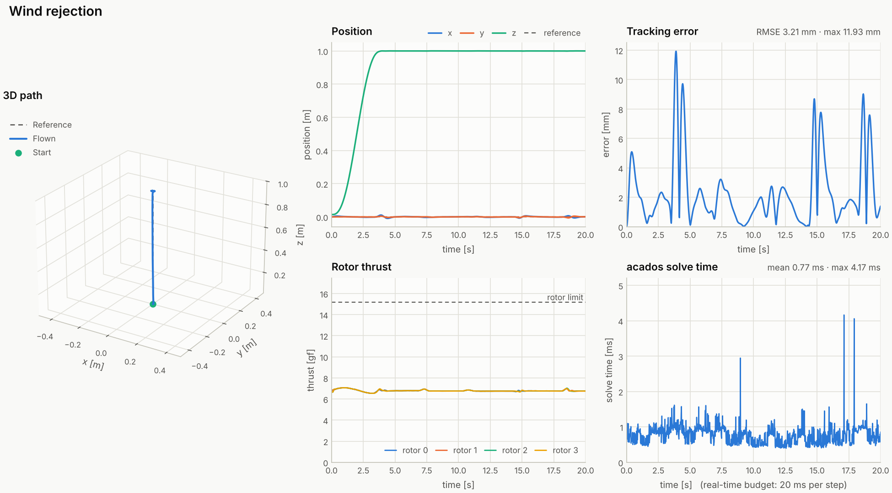
</picture>
<picture>
  <source media="(prefers-color-scheme: dark)" srcset="media/solver_timing_dark.png">
  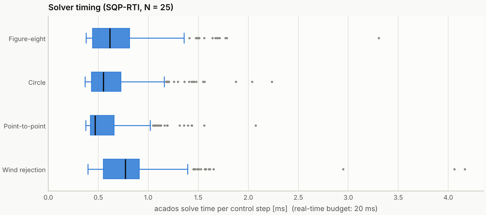
</picture>

</details>

## How it works

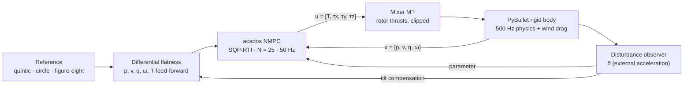

### Model

State $x = [\,p,\ v,\ q,\ \omega\,] \in \mathbb{R}^{13}$, input $u = [\,T,\ \tau\,] \in \mathbb{R}^{4}$, parameter $d \in \mathbb{R}^3$:

$$
\dot p = v,\qquad
\dot v = \frac{T}{m}\,R(q)\,e_z - g\,e_z + d,\qquad
\dot q = \tfrac12\, q \otimes \begin{bmatrix}0\\ \omega\end{bmatrix},\qquad
\dot\omega = J^{-1}\left(\tau - \omega \times J\omega\right)
$$

Crazyflie 2.x parameters: $m = 27\,\text{g}$, $J = \mathrm{diag}(1.4, 1.4, 2.17)\times10^{-5}\,\text{kg m}^2$,
arm length 39.7 mm, $k_m/k_f = 0.025\,\text{m}$, thrust-to-weight 2.25 (0.149 N per rotor).

### Optimal control problem

Solved every $\Delta t = 20\,\text{ms}$ over a 0.5 s horizon ($N = 25$, RK4 integration):

$$
\begin{aligned}
\min_{x,u}\quad & \sum_{k=0}^{N-1} \lVert x_k - x^{\text{ref}}_k\rVert_Q^2 + \lVert u_k - u^{\text{ref}}_k\rVert_R^2 \;+\; \lVert x_N - x^{\text{ref}}_N\rVert_{P}^2 \\
\text{s.t.}\quad & x_{k+1} = F_{\text{RK4}}(x_k, u_k;\ \hat d), \qquad x_0 = x_{\text{measured}} \\
& 0 \le M^{-1} u_k \le f_{\max} \qquad\qquad\ \ \text{(per-rotor thrust)} \\
& \lvert \omega_k \rvert \le \omega_{\max} \qquad\qquad\qquad \text{(soft, } \ell_1 + \ell_2 \text{ slack)} \\
& \lvert u_0 - u_{\text{prev}} \rvert \le \dot u_{\max}\,\Delta t \qquad \text{(actuator slew rate)}
\end{aligned}
$$

Inputs are normalised by hover thrust and maximum torque inside $R$, so the weights are interpretable. The solver
runs Gauss-Newton SQP-RTI with partial condensing and HPIPM, using C code generated by acados.

### References from differential flatness

For a reference acceleration $a$ and yaw $\psi$, the thrust direction must be $z_b = (a + g e_z - \hat d)/\lVert\cdot\rVert$.
Together with $\psi$ this fixes $R_{\text{ref}}$, the body rates follow from $\dot R_{\text{ref}}$, and the feed-forward
thrust is $T = m\lVert a + g e_z - \hat d\rVert$. Without this, a level-attitude reference conflicts with the tilt
that every curved path needs.

### Disturbance observer

$\hat d$ low-pass filters the gap between measured and predicted acceleration,
$\hat d \leftarrow \hat d + \alpha\left(\tfrac{v_k - v_{k-1}}{\Delta t} - \tfrac{T}{m}R e_z + g e_z - \hat d\right)$,
with a 0.15 s time constant. It enters the OCP as a parameter and also tilts the flatness references, which gives
offset-free tracking.

## Getting started

### 1. Install acados (once)

acados is a C library with a Python interface; it is not on PyPI. Follow the
[official instructions](https://docs.acados.org/installation/), or on Linux/macOS:

```bash
git clone --depth 1 --branch v0.5.1 https://github.com/acados/acados.git ~/acados
```

```bash
cd ~/acados && git submodule update --init --recursive --depth 1
```

```bash
mkdir -p build && cd build && cmake -DACADOS_WITH_QPOASES=OFF .. && make install -j4
```

```bash
export ACADOS_SOURCE_DIR=~/acados LD_LIBRARY_PATH=~/acados/lib:$LD_LIBRARY_PATH
```

Add the `export` line to your shell profile. The first solver build offers to download acados' `t_renderer` code
generator; answer `y`.

### 2. Install this project

```bash
git clone https://github.com/Anirudha-kw/acados-quadrotor-nmpc.git && cd acados-quadrotor-nmpc
```

```bash
python -m venv .venv && source .venv/bin/activate
```

```bash
pip install -e ~/acados/interfaces/acados_template -e ".[dev]"
```

### 3. Fly

Watch the figure-eight live in the PyBullet GUI:

```bash
python -m quadrotor_nmpc --scenario figure_eight --gui --realtime
```

Run headless and save a summary plot and a video of the PyBullet view:

```bash
python -m quadrotor_nmpc --scenario wind --plot wind.png --video wind.mp4
```

Compare against the controller without the disturbance observer:

```bash
python -m quadrotor_nmpc --scenario wind --no-observer
```

Scenarios: `point_to_point`, `circle`, `figure_eight`, `wind`. To regenerate everything in `media/` (on a
headless machine, wrap it in `xvfb-run -a -s "-screen 0 1920x1080x24"` to use the OpenGL renderer):

```bash
python scripts/make_media.py
```

### Use it from Python

```python
from quadrotor_nmpc import trajectory as tr
from quadrotor_nmpc.controller import NMPCConfig
from quadrotor_nmpc.scenarios import Scenario, START, run

cfg = NMPCConfig(horizon=30, w_pos=(500, 500, 800))
path = tr.quintic(START, (0, 0, 1), 3.0, cfg.dt).then(
    tr.circle(center=(-0.5, 0, 1), radius=0.5, period=3.0, n_loops=2, dt=cfg.dt)
)
log = run(Scenario("demo", "Demo", "small circle", path), cfg)
print(log.metrics())
```

## Project structure

```
quadrotor_nmpc/
├── params.py       Crazyflie parameters, mixer / inverse mixer
├── model.py        CasADi quaternion dynamics -> AcadosModel
├── controller.py   OCP formulation, SQP-RTI solver wrapper, disturbance observer
├── trajectory.py   quintic / circle / figure-eight generators, differential flatness
├── wind.py         mean + sine + 1-cos gusts + Dryden-style turbulence, quadratic drag
├── simulator.py    PyBullet plant (500 Hz, forces applied at the rotor hubs)
├── scenarios.py    benchmark scenarios, closed-loop runner, logging and metrics
├── plotting.py     result figures (light and dark themes)
├── video.py        offscreen PyBullet camera, path overlays, MP4/GIF export
└── __main__.py     command-line interface
assets/             Crazyflie URDF
scripts/            make_media.py regenerates media/
tests/              unit tests and closed-loop tests
media/              GIFs, MP4s, figures, results.json
```

## Testing

```bash
pytest -q
```

Without acados installed, the closed-loop test is skipped. CI runs ruff and the unit tests on Python 3.10 and 3.12,
and a second job builds acados from source and flies the point-to-point scenario in PyBullet.

## Assumptions and limitations

- The plant uses the same rigid-body model as the controller, with perfect state feedback and no motor dynamics,
  latency or sensor noise. The sub-millimetre nominal errors reflect that; the wind scenario is the robustness
  test. Adding a motor time constant, an estimator or delays to `simulator.py` is the natural next step before
  running on hardware.
- Yaw is held at zero. The flatness map supports a yaw reference, but no scenario uses one.
- Aerodynamic drag only acts when a wind field is enabled. Ground effect and blade flapping are not modelled.

## References

- R. Verschueren et al., "acados: a modular open-source framework for fast embedded optimal control", *Mathematical Programming Computation*, 2021.
- D. Mellinger and V. Kumar, "Minimum snap trajectory generation and control for quadrotors", *ICRA*, 2011 (differential flatness).
- J. Förster, "System identification of the Crazyflie 2.0 nano quadrocopter", ETH Zürich, 2015.
- J. Panerati et al., "Learning to fly: a gym environment with PyBullet physics for reinforcement learning of multi-agent quadcopter control", *IROS*, 2021 (Crazyflie constants).
- MIL-F-8785C, *Flying qualities of piloted airplanes* (1-cos gust and Dryden turbulence models).

## License

[MIT](LICENSE) © Anirudha Karande
